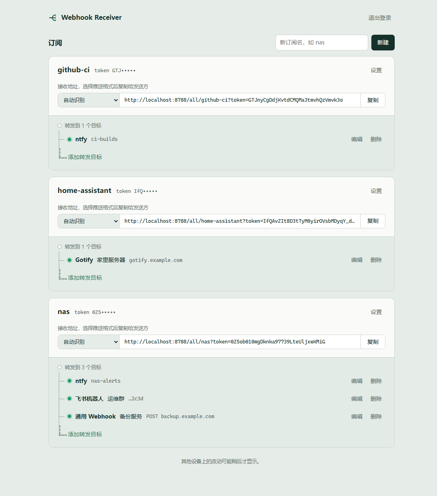
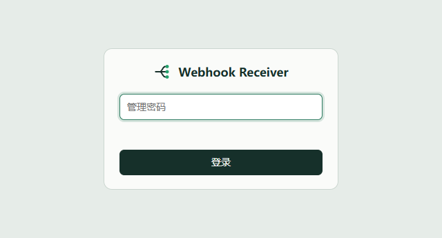
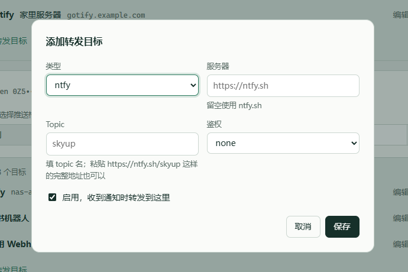

<div align="center">


# Webhook Receiver


[](https://deploy.workers.cloudflare.com/?url=https://github.com/lyzz0612/webhook-receiver)


</div>

### 📖 简介

运行在 Cloudflare Workers 上的推送通知中转服务。它冒充 Bark、ntfy、Gotify、企业微信机器人等常见推送服务的接收接口，按订阅把消息转发到一个或多个目标。只要发送方支持其中任意一种推送服务，把地址换成本服务的地址即可接入，不需要改发送方的代码。

**可接收的格式：**

🔖 自有格式 • 🔍 自动识别 • 🍎 Bark • 📣 ntfy • 🔔 Gotify • 💼 企业微信机器人 • 📌 钉钉机器人 • 🪶 飞书机器人 • 🎮 Discord Webhook • 💬 Slack Webhook • ✈️ Telegram Bot API

**可转发到：**

📣 ntfy • 🔔 Gotify • 🔗 通用 Webhook • 🪶 飞书机器人 • 💼 企业微信机器人

## ✨ 主要特性

- 🎭 **兼容常见推送接口**：11 种入站格式，发送方只需替换域名和路径
- 🔀 **一对多转发**：每个订阅最多 10 个转发目标，并发发送，可单独启用或停用
- 🔍 **自动识别**：`/all/` 入口按路径和请求体判断格式，不确定发送方用哪种格式时可直接使用
- 🔑 **订阅独立 token**：每个订阅有自己的 token，可随时重置，泄露后只影响这一个订阅
- 🖥️ **管理后台**：在 `/admin/` 新建订阅、管理目标，按格式复制完整接收地址
- 🛡️ **敏感字段掩码**：后台不回显目标的密钥和 token，编辑时留空表示不修改
- ☁️ **一键部署**：KV 命名空间自动创建，只需设置一个后台密码

## 🚀 快速开始

### 一键部署（推荐）

点击下方按钮，即可将本项目部署到你的 Cloudflare 账号，**KV 命名空间会自动创建**，无需手动配置：

[](https://deploy.workers.cloudflare.com/?url=https://github.com/lyzz0612/webhook-receiver)

> Fork 用户：将上面链接中的 `lyzz0612` 替换为你自己的 GitHub 用户名即可部署你 fork 的仓库。

部署过程中会要求你设置以下内容：

| 配置项 | 说明 |
|--------|------|
| **ADMIN_PASSWORD** | 管理后台登录密码。建议使用 `openssl rand -hex 16` 生成随机字符串 |
| **SUBS** | KV 命名空间，自动创建，无需手动配置 |

部署按钮会在你的 GitHub 账号下创建一个新仓库，并连接 Cloudflare Workers Builds，之后推送到该仓库会自动重新部署。

### 三步开始使用

1. 访问 `https://<你的 Worker 域名>/admin/`，用 `ADMIN_PASSWORD` 登录
2. 新建订阅（例如 `nas`），点“添加转发目标”配置要转发到哪里
3. 在订阅卡片上选择发送方使用的格式，复制接收地址填到发送方

## 🖥️ 管理后台

### 界面说明

- **订阅卡片**：显示订阅名和打码的 token；“设置”里可以改名、设置或随机重置 token、删除订阅
- **接收地址**：下拉框选择推送格式，旁边显示该格式的完整 URL，一键复制。每个订阅上次选的格式会记住
- **转发目标**：卡片下方的树状列表，每行显示类型、名称和配置摘要，可单条编辑、删除
- **目标编辑**：表单随类型切换字段；密钥类字段显示为掩码，留空保存表示不修改

### 界面预览




> 后台修改写入 Cloudflare KV，其他边缘节点可能要几十秒后才读到新配置。

## 📡 接收地址

```
https://<域名>/{类型}/{订阅名}/...
```

| 类型 | 示例（订阅 `nas`，token `T0k3n`） |
|---|---|
| default（自有格式） | `/default/nas?token=T0k3n`，或 `Authorization: Bearer T0k3n` |
| all（自动识别） | `/all/nas?token=T0k3n`，其余格式的路径写法同样适用 |
| bark | `/bark/nas/T0k3n/标题/内容` |
| ntfy | `/ntfy/nas/T0k3n` |
| gotify | `/gotify/nas/message?token=T0k3n` |
| wecom | `/wecom/nas/cgi-bin/webhook/send?key=T0k3n` |
| dingtalk | `/dingtalk/nas/robot/send?access_token=T0k3n` |
| feishu | `/feishu/nas/open-apis/bot/v2/hook/T0k3n` |
| discord | `/discord/nas/api/webhooks/0/T0k3n` |
| slack | `/slack/nas/services/x/x/T0k3n` |
| telegram | `/telegram/nas/botT0k3n/sendMessage` |

后台订阅卡片里可以直接复制每种格式的完整 URL，不需要手动拼。

### 自有格式

```bash
curl -H 'Authorization: Bearer T0k3n' -H 'Content-Type: application/json' \
  -d '{"title":"部署完成","body":"v1.2.3 已上线","level":"info","url":"https://example.com"}' \
  https://<域名>/default/nas
```

| 字段 | 说明 |
|---|---|
| `body` | 必填。别名 `message` / `content` / `text` / `desp` / `msg` |
| `title` | 标题，别名 `subject` |
| `url` | 点击跳转地址 |
| `level` | `info` / `warn` / `critical`，映射到 ntfy、Gotify 的优先级 |
| `tags`、`group` | 标签和分组 |
| `markdown` | `true` 时按 Markdown 发送（目标支持时） |

也支持 GET query（`/default/nas?token=T0k3n&title=..&body=..`，方便浏览器书签和 iOS 快捷指令）、表单和纯文本 body。

### 自动识别

`/all/` 入口先看 token 出现在哪个位置（`?key=`、`?access_token=`、`X-Gotify-Key` 头等），再看请求体特征（`msgtype`、`embeds`、`chat_id` 等）判断格式；都判断不出时按自有格式宽松解析。识别结果写在响应头 `X-Detected-Format` 里。

## 📤 转发目标

| 类型 | 配置 | 说明 |
|---|---|---|
| ntfy | 服务器、topic、鉴权（无 / bearer / basic） | 服务器留空用 `ntfy.sh`；topic 直接粘贴 `https://ntfy.sh/xxx` 也能识别 |
| Gotify | 服务器、App Token | `level` 映射为优先级 5 / 7 / 10 |
| 通用 Webhook | URL、方法、请求头、body 模板 | 模板变量见下方 |
| 飞书机器人 | Webhook 地址、签名密钥（可选） | `markdown=true` 时发卡片消息并按 `level` 显示颜色，有标题或链接时发富文本，否则发纯文本 |
| 企业微信机器人 | key | `markdown=true` 时用 markdown 消息 |

通用 Webhook 的 body 模板支持 `{{title}}`、`{{body}}`、`{{text}}`、`{{url}}`、`{{level}}`、`{{tags}}`、`{{group}}`，`{{json}}` 为整条消息的 JSON。Content-Type 为 JSON 时替换值会自动转义。模板留空时发送整条消息的 JSON。

转发结果：

- 至少一个目标成功就返回成功，避免发送方重试导致已成功的目标重复收到消息
- 各目标结果在响应头 `X-Forward-Result` 里，例如 `t1=ok; t2=error:timeout`
- 全部失败或没有启用的目标时返回 502

## ☁️ 其他部署方式

### 连接已有的 GitHub 仓库（Workers Builds）

在 Cloudflare Dashboard 中通过 **Workers & Pages → Create → Import a repository** 选择本仓库（或你的 fork）。构建命令留空，部署命令使用默认的 `npx wrangler deploy`。KV 同样会在首次部署时自动创建。

部署后在 Worker 的 **Settings → Variables and Secrets** 中添加 secret `ADMIN_PASSWORD`。之后每次推送都会自动部署。

### 命令行

```bash
npm install
npx wrangler deploy
npx wrangler secret put ADMIN_PASSWORD
```

- KV 命名空间在首次部署时由 Wrangler 自动创建
- `SESSION_SECRET` 可选；不设置时会话签名密钥由 `ADMIN_PASSWORD` 派生，修改密码会让所有已登录会话失效

### GitHub Actions

`.github/workflows/deploy.yml` 会在推送到 `main` 时运行测试并部署。如果已经用 Workers Builds 连接了仓库，就不要再配置下面的 secrets，否则每次推送会部署两次。需要在仓库的 Settings → Secrets and variables → Actions 中添加：

- `CLOUDFLARE_API_TOKEN`：需要 Workers Scripts 编辑、Workers KV Storage 编辑权限
- `CLOUDFLARE_ACCOUNT_ID`
- `ADMIN_PASSWORD`：后台密码，部署时作为 Worker secret 上传
- `SESSION_SECRET`（可选）

GitHub 里没有设置的 Worker secret 会保留 Cloudflare 上已有的值。没有设置 `CLOUDFLARE_API_TOKEN` 时，工作流只跑测试、跳过部署。

## ⚙️ 配置

| 名称 | 类型 | 说明 |
|---|---|---|
| `ADMIN_PASSWORD` | Secret，必填 | 后台登录密码 |
| `SESSION_SECRET` | Secret，可选 | 会话签名密钥，不设置时由 `ADMIN_PASSWORD` 派生 |
| `SUBS` | KV 绑定 | 存储订阅、token 和转发目标，自动创建 |
| `LOGIN_LIMITER` | 限流绑定 | 后台登录每个 IP 每分钟 10 次，无需配置 |

## 🔧 开发

```bash
cp .dev.vars.example .dev.vars   # 填入本地后台密码
npm install
npm run dev                      # http://localhost:8787/admin/
npm test
npm run typecheck
```

设计细节（URL 结构、数据模型、自动识别规则、后台接口）见 [docs/design.md](docs/design.md)。

## 📝 注意事项

- 订阅名只能包含小写字母、数字、`_` 和 `-`，最长 64 位；改名后所有接收地址都会变化
- token 需为 8–128 位，可包含字母、数字和 `. _ ~ : -`，不设置时自动生成
- 服务不记录消息日志。排查转发失败可以看响应头 `X-Forward-Result`，或用 `npx wrangler tail` 查看实时日志
- 如果 Worker 和转发目标（例如自建 ntfy）在同一个 Cloudflare 域名下，注意该域名的 SSL 模式：Flexible 模式下 Worker 到源站的请求会走 HTTP

## 🤝 参与贡献

欢迎提交 Issue 和 Pull Request。
